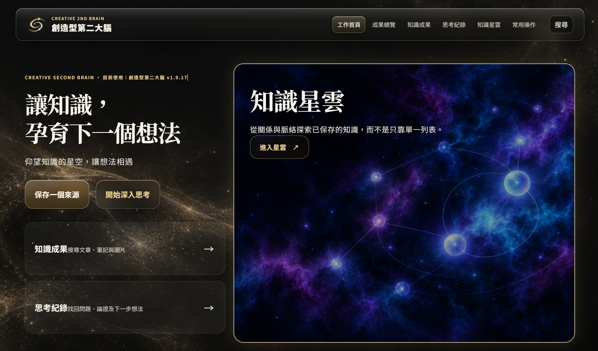
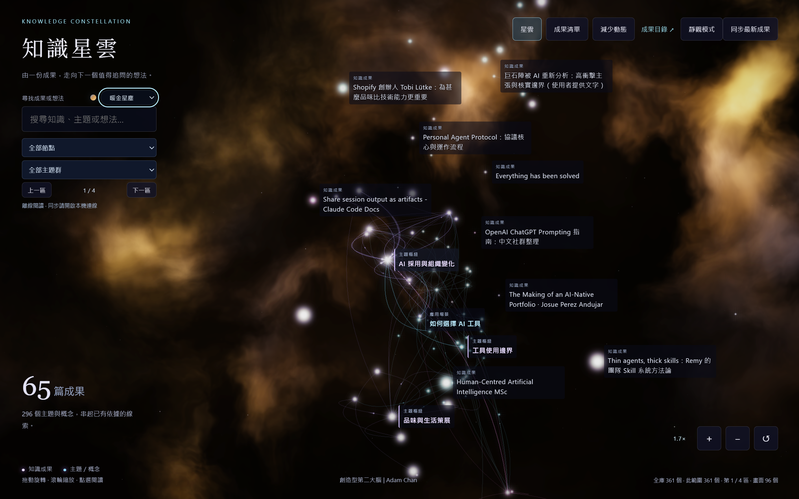

  

<h1 align="center">創造型第二大腦</h1>

<strong>CREATIVE 2ND BRAIN</strong>

你的材料，你的第二大腦。 仰望知識的星空，讓想法相遇。

你有沒有存下很多文章，真正要用時，卻想不起哪一篇說過甚麼？

創造型第二大腦幫你把值得留下的文章、文字和圖片，整理成自己的知識庫。你可以回頭讀原文、找出材料之間的關係，再請 AI 幫你思考問題、比較觀點，或寫成新的作品。

**你提供材料和想做的事；AI 負責整理與技術操作，重要判斷仍由你決定。**

[認識功能](#features) · [開始安裝](#install) · [日常使用](#use) · [更新與備份](#keep)

## 不只存起來，還能用起來

這是一套讓 AI 協助你管理和使用知識的工具，不是另一個只收集連結的書籤夾，也不是下載後雙擊就能使用的獨立 App。它需要配合能操作你電腦檔案的 AI 工具，並用 Obsidian 閱讀筆記。Obsidian 是一款筆記軟體；你的「知識庫」就是電腦上一個保存筆記與圖片的資料夾。

你可以用它做這些事：

- **留下完整材料。** 保存公開文章、論文、你貼上的文字或原圖，分清原文內容與 AI 的解讀。處理 YouTube 時使用已有字幕，不下載影片，也不把影片簡介當成全文。
- **把重點看清楚。** 整理重要觀點與來源；圖片功能可用時，製作資訊圖，把較複雜的內容變得容易閱讀。
- **讓舊知識接上新問題。** 從已保存的材料找依據、比較不同說法，留下日後可以回看的思考紀錄。
- **用自己的材料創作。** 把零散筆記整理成比較、報告或文章。新作品不會未經你要求就自動加入知識庫。
- **有方向地探索。** 評估一份新材料是否值得保存，或按你選定的主題展開研究；也可從已保存材料的分歧與證據缺口取得下一步建議。建議只供你選擇，不會自行在背景每天執行研究。
- **從關係找靈感。** 用「知識星雲」查看已保存知識之間的連結，不必只靠逐篇翻找。
- **接續與維護。** 找回中斷的工作、核對某份成果、修復指定問題、整理目錄，以及安全更新工具。

*知識成果：回看已保存材料的重點、來源與圖像整理。*

*知識星雲：查看不同材料之間的連結，從關係找到下一步。*

以上為使用畫面示例；內容與數量取決於你保存的材料，新安裝的知識庫為空白。

例如，你正在準備一份「怎樣學得更有效」的報告：先保存幾篇學習方法的文章，再請 AI 比較它們的共同點與分歧，最後用這些材料整理報告。日後讀到新文章，也能回頭看看它補充或挑戰了甚麼。

## 開始安裝：把技術工作交給 AI

你需要一部用來保存筆記的電腦，以及能在那部電腦讀寫檔案、執行安裝工作的 AI 工具。只有網頁聊天或上傳附件的介面，不一定能替你的電腦安裝。若要製作新的資訊圖，目前還需要 Codex 內建的圖片生成功能；AI 應先確認你能使用哪些功能。

### 1. 取得完整安裝包

打開 [最新正式版本](https://github.com/Adamchanadam/creative-second-brain/releases/latest)，在 **Assets（下載檔案）** 中下載名稱為 `creative-second-brain-版本號.zip` 的檔案。

不要選 `Source code (zip)` 或 `Source code (tar.gz)`；那是程式原始檔，不是完整安裝包。把下載好的 ZIP 交給 AI，或告訴它 ZIP 在你電腦上的位置。

### 2. 請 AI 處理安裝

打開 [安裝提示文字](install-prompt.txt)，把全文複製到同一個 AI 對話，並告訴它：

> 請按這份提示和我提供的完整安裝包，幫我安裝創造型第二大腦。我不熟悉技術，請由你完成檢查、安裝和核對；需要我批准或操作的地方，請用日常語言說明。

AI 會先檢查電腦，再問你的顯示名稱、筆記庫名稱、存放位置，以及是否同意安裝缺少的工具。不懂怎樣選資料夾，可以請它提出建議。你不用自己輸入終端命令。

**已經有筆記的人，請一開始就告訴 AI。** 由本工具 1.9.15 起建立的知識庫可先檢查再升級；其他舊筆記庫未必能直接接入。AI 必須先說明能否沿用，不得擅自搬移、覆寫或另建一份來冒充完成。

### 3. 完成必要設定，拿到自己的首頁

AI 會交給你正確的筆記資料夾，指引你在 Obsidian 選擇 **Open folder as vault（開啟資料夾作為知識庫）**。它也會指引你啟用 Obsidian 的「命令列介面」——這是讓 AI 能核對筆記位置的功能，不是要你自己打命令。畫面位置不同時，把畫面交給 AI 判斷。

安裝完成後，你應拿到：

- 自己的第二大腦首頁，以及筆記保存的位置。
- 可在 AI 對話使用的功能入口。
- 清楚的核對結果：哪些功能可用、哪些仍受限制。

新筆記庫是空白的，所以一開始沒有知識或連線很正常。安裝不會替你塞入示範筆記，也不應用「已安裝」掩蓋尚未可用的功能。

## 日常使用：先保存，再思考與創作

使用前，讓 AI 開啟你安裝時選定的第二大腦資料夾。下列以 `$brain-` 開頭的文字，是在 **AI 對話中** 使用的功能名稱，不是終端命令。安裝時，AI 應已確認你的工具能否辨識它們；若不支援這種寫法，請 AI 說明對應的用法。

不必一次記住所有功能。先從你手上的一份材料開始：

| 想做甚麼 | 貼到 AI 對話的例子 |
|---|---|
| 開啟自己的首頁 | `$brain-guide` |
| 保存一篇文章 | `$brain-url`，後面貼上文章網址 |
| 保存一段文字 | `$brain-text`，下一行貼上完整原文 |
| 保存一張圖片 | `$brain-image`，並附上原圖 |
| 為已入庫知識製作資訊圖 | `$brain-infographic KS-VS-0057` |
| 修復指定問題 | `$brain-fix`，後面補上材料名稱或問題描述 |
| 用已存材料思考 | `$brain-think 請比較庫內不同學習方法的共同點與分歧，列出依據。` |
| 把材料變成作品 | `$brain-create 請用庫內的學習方法材料，整理一份給同學看的報告。` |
| 看知識之間的關係 | `$brain-nebula` |

保存完成後，請 AI 打開成果頁。你可以先閱讀整理後的內容、來源與知識點，並回到已保存的來源筆記；如已製作資訊圖，也可一併查看。資訊圖尚未製作不會阻礙文字成果入庫，日後需要時再明示補做。思考時也可以要求 AI 說清楚：「哪一部分有資料支持？哪一部分只是推論？」

需要其他功能時，在自己的首頁查看全部操作即可：評估新來源用 `$brain-grow`、研究主題用 `$brain-research`、整理目錄用 `$brain-tidy`。工作中斷用 `$brain-resume` 並說明要接續哪件事；核對成果用 `$brain-check`，修復指定問題用 `$brain-fix`。要為已入庫知識補製可選資訊圖，使用 `$brain-infographic <知識頁ID>`；已有圖會先回傳原有成果，不會自動畫。

## 更新與備份：留下的知識，繼續由你保管

### 更新工具，不重建筆記庫

已安裝 `brain-update` 的使用者，在原來的第二大腦資料夾中向 AI 輸入 `$brain-update`。AI 會從這個 GitHub 專案的正式版本檢查更新，保留原有知識與個人設定。遇到檔案衝突或未完成的更新，應先停下說明，不直接覆蓋。

如果你仍使用 1.9.15、還沒有這個入口，從 [最新正式版本](https://github.com/Adamchanadam/creative-second-brain/releases/latest) 取得完整 ZIP，連同 [安裝提示文字](install-prompt.txt) 交給 AI，清楚說：「我要升級原有第二大腦，保留所有筆記和設定，不要重新建庫。」AI 會使用新安裝包檢查原有資料，符合條件才更新。

### 備份整份資料，不只存首頁連結

筆記與圖片保存在你選定的電腦資料夾。首頁只是閱讀入口，並不是備份。請 AI 幫你確認備份範圍，保留整個第二大腦資料夾及完整技能包；技能包就是 AI 操作這套工具所需的檔案。

換電腦時，把備份交給新電腦上的 AI，先核對位置、版本和可用工具。不要直接把舊電腦的首頁網址當作新電腦的入口。

## 使用前，還有幾件事要知道

- **本機保存，不等於完全離線。** 筆記在你電腦，不會因使用這個 GitHub 專案就被公開；但請 AI 分析內容時，資料如何處理，仍取決於你使用的 AI 服務及授權。敏感材料應先確認可以交給該服務。
- **AI 仍可能看錯或理解錯。** 重要用途要回看來源。圖片看不清、文章無法取得全文或字幕不足時，應如實標示，不能用猜測補齊。
- **功能取決於實際工具。** 圖片生成、瀏覽器操作和自動安裝，需要相應能力及權限。AI 服務可能有自己的收費或用量限制；這套工具不會替你取得那些能力。
- **不同電腦要各自確認。** 安裝方法按實際系統處理；目前未完成 Mac 或第二部實機的完整驗收，不能保證每部電腦都已測試過。
- **遇到問題，直接把現象交給 AI。** 說清楚你想做甚麼、在哪一步停住，附上畫面或錯誤訊息。讓 AI 先找原因，不必自己猜命令或刪檔重裝。

---

讓知識，孕育下一個想法。 創造型第二大腦 | Adam Chan

